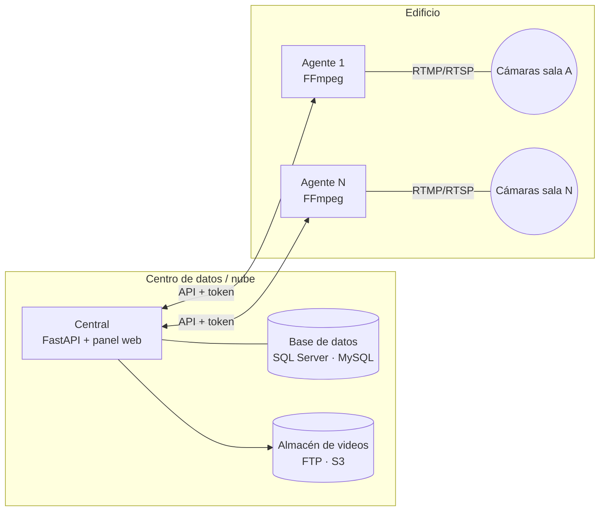
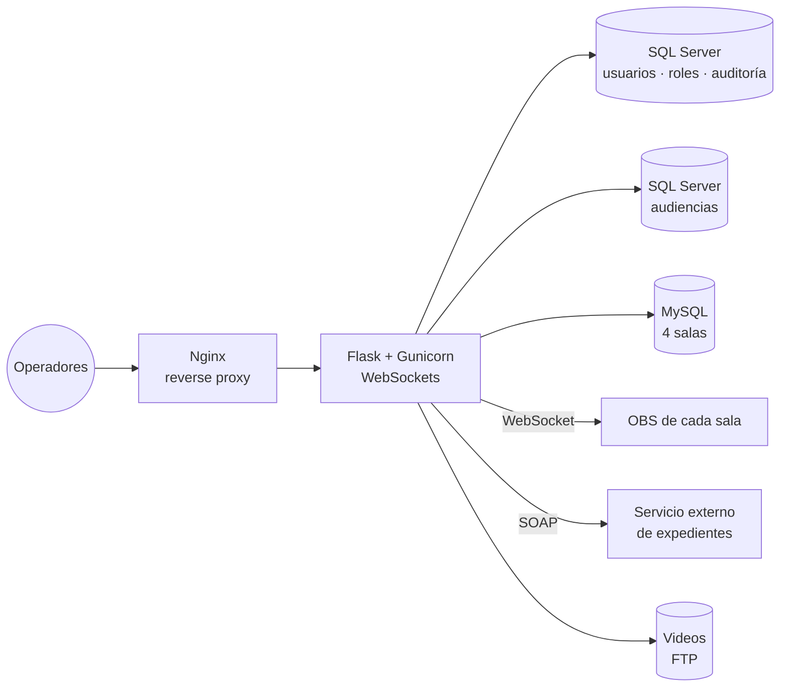
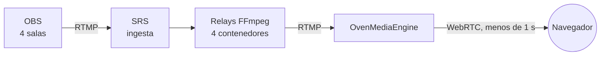

<!-- Encabezado -->

  

  

  
  
  

---

### 👨‍💻 Sobre mí

- 🏛️ Desarrollo y opero **sistemas de grabación y gestión de audiencias** en el sector judicial: aplicaciones web, bases de datos y streaming de video en tiempo real.
- 🐳 Contenerizo y documento infraestructura completa con **Docker Compose**: apps Flask, Nginx, SQL Server, MySQL, FTP y servidores de streaming.
- 📡 Construyo pipelines de video **RTMP → WebRTC** (OBS, SRS, FFmpeg, OvenMediaEngine) para transmisiones en vivo de baja latencia.
- 🚀 Hoy me enfoco en **DevOps**: CI/CD, infraestructura como código, observabilidad y nube.

### 🛠️ Stack

**Lenguajes y backend**

  

**Infraestructura y DevOps**

  

**Bases de datos y streaming**

  
  &nbsp;
  
  
  
  

### 💼 Proyectos profesionales

> El código de estos sistemas es privado porque está en producción en una institución. Aquí está **qué resuelven, cómo están construidos y qué hice yo**.

---

#### 🎥 Grabador distribuido de audiencias · *arquitecto y desarrollador*

Sistema que **reemplaza un software comercial de grabación**: una central coordina agentes instalados junto a las cámaras de cada sala, que graban, vigilan la señal y entregan el video final.

  
  
  
  
  
  

- Diseñé la arquitectura **central + agentes**: los agentes no guardan lógica de negocio y la central no guarda estado en memoria, así que **escala horizontalmente**.
- **Grabación tolerante a fallos**: pausa, reanudación y unión de tramos en MP4. Si el proceso se detiene, cierra los archivos íntegros y al volver recupera las grabaciones.
- **Instalador offline** para Ubuntu 16.04+ y Windows, con servicio **systemd**, actualización y desinstalación.
- Configuración 100 % por **variables de entorno**, base de datos intercambiable, monitoreo de salud y envío con reintentos.
- Documentación completa: arquitectura, despliegue, diccionario de datos y roadmap a **AWS** (ECS/Fargate, RDS, S3).

---

#### 🏛️ Plataforma de gestión y grabación de audiencias · *full-stack + operación*

Aplicación web **en producción** que centraliza la operación de las salas: agenda de audiencias, estado de grabación en vivo, control remoto de OBS, reportes y auditoría.

  
  
  
  
  
  
  

- Integré **7 bases de datos** (3 SQL Server y 4 MySQL) y servicios externos (SOAP, OBS WebSocket) en una sola plataforma.
- **Seguridad**: roles y permisos por módulo, bitácora de auditoría de más de 1 M de eventos y **URLs firmadas con HMAC** con expiración para descargar videos.
- Contenericé la app (**Docker + Gunicorn/eventlet + Nginx**) con healthchecks, separación dev/prod y script de despliegue.

---

#### 🐳 Infraestructura contenerizada y streaming en vivo · *DevOps*

Toda la infraestructura del servidor como código: **11 contenedores** documentados, reproducibles y con guías de instalación.

> 🔓 **Demo pública de esta arquitectura:** [streaming-rtmp-webrtc-stack](https://github.com/osvaldo96-reyes/streaming-rtmp-webrtc-stack). Se levanta con `docker compose up` y tiene CI con lint, escaneo de seguridad y prueba de punta a punta.
>
> 

- Pipeline de video en vivo **RTMP → WebRTC** de baja latencia (SRS, FFmpeg, OvenMediaEngine).
- Pasé contenedores creados a mano con `docker run` a **Docker Compose versionado** en Git, con secretos fuera del repo (`.env.example`) y un mapa de puertos.
- **Diagnóstico y operación**: análisis de almacenamiento de SQL Server, respaldos verificados y plan de migración a **volúmenes persistentes** con rollback automático.
- Auditoría de seguridad de repositorios: detección y retiro de credenciales expuestas.

---

### 🧭 Ruta DevOps

| Área | Estado |
|---|---|
| Linux, Bash, redes | ✅ En producción |
| Docker y Docker Compose | ✅ En producción |
| Nginx (reverse proxy) | ✅ En producción |
| Git y GitHub | ✅ |
| CI/CD con GitHub Actions | ✅ Lint, escaneo de seguridad y pruebas E2E |
| Kubernetes | 🔜 |
| Terraform (IaC) | 🔜 |
| AWS / nube | 🔜 |
| Prometheus + Grafana | 🔜 |

### 📊 Actividad

  
  

  

  <picture>
    <source media="(prefers-color-scheme: dark)" srcset="https://raw.githubusercontent.com/osvaldo96-reyes/osvaldo96-reyes/output/github-contribution-grid-snake-dark.svg"/>
    
  </picture>

  

